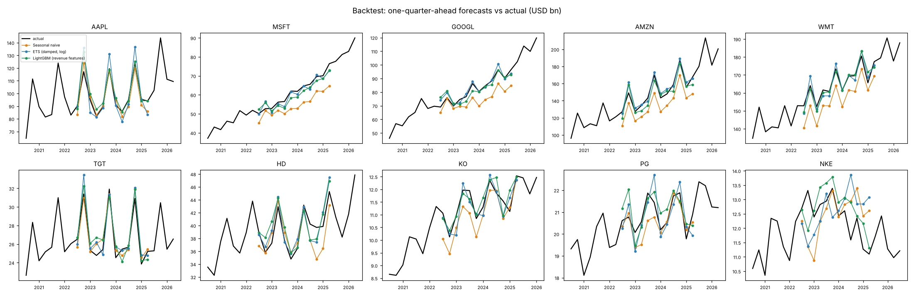
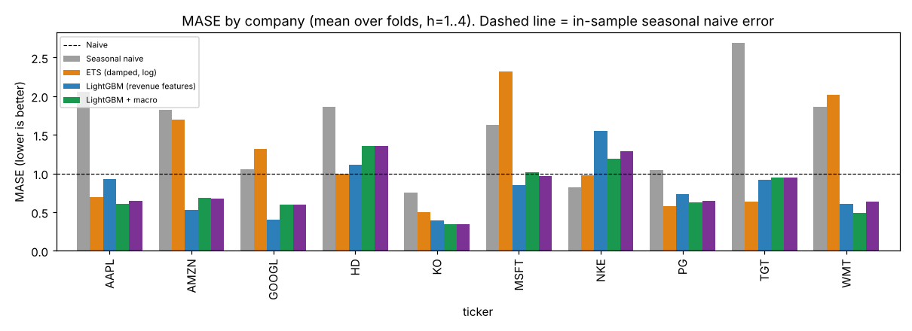
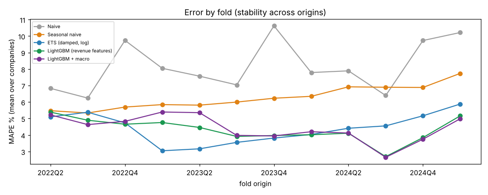

# ForecastLab

A reproducible pipeline that forecasts quarterly revenue for 10 US public companies from free SEC EDGAR data. It compares naive, seasonal naive, and ETS baselines with a global LightGBM model under a rolling-origin backtest. One command reproduces everything, and every number below is copied from files the pipeline writes under `reports/`.

**Headline:**
- **Simple baselines.** LightGBM clearly beats naive and seasonal naive. It cuts MASE by 33% versus seasonal naive (0.787 vs 1.171).
- **ETS.** It does **not** beat a well-specified ETS. The difference is −0.015 MASE, and the 95% CI of −0.139 to +0.104 includes zero.
- **Macro features.** Adding US retail sales and CPI did not help. LightGBM + macro scored MASE 0.811 against 0.787 without them, a +0.024 difference whose company-level CI of [−0.004, +0.060] includes zero. It was, however, the most stable model across folds.
- **Per company.** ETS and seasonal naive are each the best model for 3 of the 10 companies. LightGBM is best for 2, and LightGBM + macro and naive for 1 each.

SEC data was downloaded on 2026-10-21 and FRED data on 2026-10-22. On the first day FRED was in maintenance.

## Quickstart

```bash
python -m pip install -e ".[dev]"          # Python >= 3.11
export SEC_USER_AGENT="Your Name your.email@example.com"   # SEC asks for a contact in the User-Agent
make test         # 30 unit tests incl. 7 leakage tests, no network needed
make reproduce    # ingest (cached) -> quality -> backtest -> SHAP -> export -> monitor  (~30 s after download)
make offline      # rerun modelling from the committed data/processed/ (no network)
make spark        # optional PySpark re-implementation of features + LightGBM backtest, with parity check
```

The pipeline is deterministic. Running `make clean && make reproduce` twice gave byte-identical `results_summary.csv`, `metrics_by_fold.csv`, and `bootstrap_ci.csv`.

## Results

**Backtest design:**
- 10 companies;
- 12 rolling origins with an expanding window (2022Q2 to 2025Q1);
- horizons h = 1–4, so targets run from 2022Q3 to 2026Q1;
- 480 forecasts per model.

Metrics are computed per (company, fold) over the 4 horizons, then averaged over the 120 cells. Source: `reports/results.md`.

| Model | MAPE % | sMAPE % | MASE | MASE median | Fold MAPE std | Fold MAPE var | # companies best (MASE) |
|---|---|---|---|---|---|---|---|
| Naive | 8.176 | 8.343 | 1.560 | 1.417 | 3.064 | 11.784 | 1 |
| Seasonal naive | 6.266 | 6.520 | 1.171 | 0.907 | 1.872 | 4.445 | 3 |
| ETS (damped trend, log) | 4.405 | 4.365 | 0.802 | **0.689** | 2.043 | 5.180 | 3 |
| LightGBM (revenue features) | **4.324** | **4.303** | **0.787** | 0.720 | 1.851 | 4.117 | 2 |
| LightGBM + macro | 4.423 | 4.398 | 0.811 | 0.730 | **1.772** | **3.624** | 1 |

"Fold MAPE std/var" measures stability. For each company it takes the spread of fold-level MAPE across the 12 folds, then averages over companies.

**Bootstrap 95% CIs on mean MASE difference** (LightGBM minus comparator; negative means LightGBM is better). Each comparison resamples whole companies, with 5,000 resamples.

| Comparison | Mean diff | 95% CI (resample companies) | 95% CI (resample company×fold cells) |
|---|---|---|---|
| vs Naive | −0.774 | [−1.157, −0.398] | [−0.934, −0.616] |
| vs Seasonal naive | −0.385 | [−0.804, −0.004] | [−0.533, −0.238] |
| vs ETS | −0.015 | [−0.139, +0.104] | [−0.098, +0.063] |
| vs LightGBM + macro | −0.024 | [−0.060, +0.004] | [−0.060, +0.009] |
| *LightGBM + macro* vs Seasonal naive | −0.360 | [−0.765, +0.025] | [−0.503, −0.217] |
| *LightGBM + macro* vs ETS | +0.009 | [−0.096, +0.112] | [−0.073, +0.089] |

The company-level bootstrap is the honest interval: consecutive folds overlap, so cells from the same company are correlated. Against seasonal naive, that interval only just excludes zero for LightGBM, and does **not** exclude zero for LightGBM + macro.

**MAPE % by horizon:**

| Model | h=1 | h=2 | h=3 | h=4 |
|---|---|---|---|---|
| Naive | 8.02 | 9.06 | 8.98 | 6.64 |
| Seasonal naive | 6.07 | 6.08 | 6.27 | 6.64 |
| ETS | 3.58 | 4.55 | 4.55 | 4.93 |
| LightGBM | 3.35 | 4.28 | 4.58 | 5.09 |
| LightGBM + macro | 3.43 | 4.35 | 4.68 | 5.23 |

**MASE by company** (bold = best):

| Company | Naive | Seasonal naive | ETS | LightGBM | LightGBM + macro |
|---|---|---|---|---|---|
| AAPL | 2.060 | 0.690 | 0.928 | **0.609** | 0.649 |
| AMZN | 1.826 | 1.693 | **0.527** | 0.681 | 0.678 |
| GOOGL | 1.059 | 1.316 | **0.400** | 0.601 | 0.596 |
| HD | 1.862 | **0.992** | 1.113 | 1.354 | 1.357 |
| KO | 0.749 | 0.502 | 0.390 | 0.3421 | **0.3417** |
| MSFT | 1.631 | 2.315 | **0.854** | 1.012 | 0.970 |
| NKE | **0.819** | 0.980 | 1.549 | 1.195 | 1.288 |
| PG | 1.043 | **0.575** | 0.729 | 0.631 | 0.642 |
| TGT | 2.687 | **0.634** | 0.920 | 0.948 | 0.948 |
| WMT | 1.866 | 2.016 | 0.610 | **0.494** | 0.639 |





## What the ML model does not beat

* **ETS overall.** The aggregate difference is 0.015 MASE (1.8% lower MAPE), and the CI includes zero. ETS also has the better median MASE (0.689 vs 0.720). The fair claim is "LightGBM matches ETS", not "LightGBM beats ETS".
* **ETS on the steady growers.** ETS is better for AMZN (0.527 vs 0.681), GOOGL (0.400 vs 0.601), and MSFT (0.854 vs 1.012). These series have smooth trends, which a damped trend captures well.
* **Seasonal naive on the stable, seasonal retailers.** Seasonal naive is better for HD (0.992 vs 1.354), TGT (0.634 vs 0.948), and PG (0.575 vs 0.631).
* **Naive on NKE.** On NKE nothing beats "last quarter carried forward" (0.819 vs 1.195 for LightGBM). Nike's revenue turned down in 2024, and every model that uses trend or YoY momentum kept projecting growth.
* **Long horizons.** LightGBM wins at h = 1–2. At h = 3–4 ETS is level or better (4.55 vs 4.58 at h=3, 4.93 vs 5.09 at h=4).
* **Its own simpler version.** Adding macro features did not improve accuracy at any horizon. LightGBM + macro is better for 5 companies (AMZN, GOOGL, KO, MSFT, TGT) and worse for the other 5. The biggest loss is WMT, 0.639 vs 0.494.

## Explainability (SHAP)

SHAP values are computed out-of-sample: each fold's model explains only its own test rows. That gives 480 rows, and the full table is in `reports/explainability.md`. The units are YoY log growth, so a mean |SHAP| of 0.01 moves the forecast by roughly 1% of revenue.


**Which drivers matter:**
- **Latest quarter's YoY growth** (`yoy_0`, mean |SHAP| 0.027) dominates. The model is mostly a momentum model: "next year-over-year growth looks like the latest year-over-year growth".
- **Longer-run context** comes next: the 8-quarter rolling mean of YoY growth (0.009), the base quarter's position versus its trailing-4 average (0.007), and the 4-quarter rolling mean (0.007).
- **Calendar-quarter flags** contribute almost nothing (≤0.0003). This is expected, because predicting YoY growth on top of the same quarter last year already removes most seasonality.
- **Macro features**, in the macro variant (`reports/figures/shap_summary_lgbm_macro.png`): retail sales YoY ranks 5th (mean |SHAP| 0.0039) and CPI YoY ranks 8th (0.0026). The model uses them a little, but they add no accuracy over company momentum, which already reflects the same economy.

**Where it fails** (largest errors, from `reports/explainability.md`):
1. **Turning points.**
   - NKE 2024Q3: 18.0% error, forecast $13.7B vs actual $11.6B.
   - GOOGL 2022Q4: 15.9% error, forecast $88.2B vs actual $76.0B.

   In both cases the momentum features (`yoy_0`, `yoy_mean8`) pushed the forecast toward the recent trend just as it reversed: Nike's 2024 decline and Alphabet's 2022 ad slowdown after the 2021 boom. No feature in this model can anticipate a break.
2. **53-week fiscal years.**
   - HD 2025Q4: 14.9% error at h=4, and +12.9% on average across horizons. HD's fiscal Q4 2024 had 14 weeks instead of 13. That inflates both the base quarter and the latest YoY growth feature (`yoy_0` SHAP +0.037), so the error compounds. Seasonal naive, affected only through the base, over-forecast by 3.9%.
   - TGT 2024Q4, whose base quarter also had 14 weeks, shows a smaller version: all three models over-forecast by 3–4%.
   - The readiness reports flag these quarters. The fix would be a weeks-per-quarter adjustment, which I deliberately did not add after seeing the test results, because that would be tuning on the test set.

## Data

* **Source.** SEC `companyfacts` API, one JSON per company, cached in `data/raw/edgar/` (38 MB, git-ignored) with a download manifest. The processed panel (678 company-quarters) is committed in `data/processed/`.
* **Revenue tags.**
  - Primary: `Revenues`, then `RevenueFromContractWithCustomerExcludingAssessedTax`.
  - Documented fallbacks for pre-2018 history: `SalesRevenueNet` and `SalesRevenueGoodsNet`. Coca-Cola used the latter before 2017.
  - The tag behind every quarter is recorded. Each tag switch is checked for a level break on quarters where both tags report.
* **Point-in-time values.** Each quarter's value comes from its **earliest filing under any revenue tag**: what the market saw first. Latest values are kept only to measure restatements. An earlier version took "first filing" per tag. The runtime leakage guard caught that bug: after a tag switch, the new tag's value first appears a year later, as a prior-year comparative.
* **Fiscal Q4 and other missing quarters** are derived from two cumulative facts with the same start, e.g. annual minus 9-month YTD. The earlier figure is taken as it was known on the later filing's date.
  - The two facts may come from different tags only if those tags agree to within 0.5% on the periods both report.
  - A derived value must be positive and plausible (0.2–5× the average quarter). This guard exists because of a real case: PG's FY2014 10-K has a mis-tagged `Revenues` fact of $29.4B against $83.1B total sales, which would otherwise have produced a −$34.6B quarter.
  - 92 of 678 quarters are derived.
* **Calendar alignment.** Fiscal quarters are mapped to the nearest calendar quarter end. For example, Walmart's quarter ending Apr 30 becomes Q1.
* **Validation.** Ten spot-checked quarters (one per company, four of them derived) match the companies' reported revenue exactly.

**Data readiness** (`reports/data_readiness/<TICKER>.md`). Each report covers:
- missing quarters, duplicate filings, and values changed between filings;
- restatements, units, tag switches and disagreements, and calendar collisions;
- 53-week quarters, outliers, and staleness;
- candidate driver coverage and material gaps.

| Company | Verdict | Quarters | Main caveats found |
|---|---|---|---|
| AAPL | READY | 70 | 2009 quarters restated +17–24% (consistent with Apple's retrospective 2009–10 revenue-recognition change); 14-week quarters 2011Q4, 2016Q4, 2022Q4 |
| MSFT | CAVEATS | 70 | ASC 606 break at 2018Q2 (+5.1% level shift between tags; restatements up to +9.8%) |
| GOOGL | READY | 48 | history starts 2014Q3: Alphabet's CIK only exists from 2015, and earlier Google Inc. filings are under a different CIK |
| AMZN | CAVEATS | 70 | 2011Q1–Q3 "restatements" equal the 2012 quarters exactly, so probably mis-dated XBRL facts in later filings (flagged automatically; first-reported values are correct) |
| WMT | CAVEATS | 70 | 2010–2011 Q4s use net sales instead of total revenue (−0.74%) |
| TGT | CAVEATS | 70 | definition change at 2014Q1 (total revenue → sales, −2.1%); 8 restatements >1% (likely the Canada exit) |
| HD | READY | 70 | 14-week quarters 2012Q4, 2018Q4, 2024Q4 |
| KO | CAVEATS | 69 | **stale**: KO filed a 10-Q on 2026-07-29, but companyfacts did not contain it on 2026-10-21, so KO ends at 2026Q1 and caps the common data end; restatements up to +10.7% (consistent with the CCBA reclassification) |
| PG | CAVEATS | 70 | 18 restatements >1%, up to −9.7% (likely discontinued operations: beauty brands, Duracell) |
| NKE | CAVEATS | 71 | 5 restatements >1%, up to −12.9% (likely Umbro / Cole Haan divestitures); COVID 2020–21 outliers |

## Models

| Model | Description |
|---|---|
| Naive | last quarter carried forward |
| Seasonal naive | same quarter last year |
| ETS | Holt-Winters on log revenue: damped additive trend, additive seasonality (period 4), refit per company per fold. Zero fallbacks to seasonal naive were needed |
| LightGBM | one global model across companies. It predicts YoY log growth of the target quarter, and the forecast is y[t−4] × exp(growth). Features: horizon, target-quarter flags, the last 4 YoY growths, 4- and 8-quarter rolling means of YoY growth, YoY volatility and acceleration, last QoQ change, the base quarter's own YoY growth, and the base and latest quarter vs the trailing-4 average |

LightGBM hyperparameters are fixed a priori in `config.py` (300 trees, 8 leaves, L1 loss) and were **not tuned on the backtest**.

## Leakage controls

1. Features are built only from a series truncated at the origin. `origin_features` raises if it is handed future data.
2. A training row is used only if its **target** quarter is at or before the fold origin.
3. Every fold asserts at runtime that each training label was filed with the SEC on or before the forecast date. The forecast date is the day the last of the 10 companies filed the origin quarter. The same check covers macro publication dates.
4. `tests/test_leakage.py` (7 tests) replaces all revenue and macro values after the origin with random garbage, then asserts that features **and the backtest forecasts of all models** are bit-identical. It also checks that the guard catches an injected future label and a label filed after the forecast date.

## Integration prototype (Anaplan-style export)

`exports/anaplan_revenue_import.csv` has the columns `Version, Time Period, Line Item, Entity, Value`, in USD millions, and 240 rows:
- 8 quarters of actuals;
- 4-quarter forecasts from origin 2026Q1, for the versions `Fcst_LightGBM`, `Fcst_LightGBM_Macro`, `Fcst_ETS`, and `Fcst_SeasonalNaive`.

`exports/data_dictionary.csv` documents each column. A Pandera schema validates the file before it is written (`exports/validation_report.txt`). It checks:
- types and allowed values;
- the `Q3 FY26` period format;
- values are finite and greater than zero;
- unique keys and no extra columns;
- forecasts fall after the entity's last actual.

Six kinds of corrupted file are tested and rejected.

## Monitoring

`python -m forecastlab monitor` compares stored forecasts with actuals that arrived after the forecast origin.

* A company is flagged when its absolute error exceeds **both** 8% and 2× its own backtest MAPE.
* The run recommends **RETRAIN** if at least 30% of companies breach, or if errors are systematically one-signed with a mean above 4%. It recommends **REVIEW** for any single breach, and **OK** otherwise.

Results on real data:
* **Origin 2025Q4 → REVIEW.** KO 2026Q1 was under-forecast by 8.6% (threshold 8.0%). The other 9 companies were within threshold. Nine of the ten first-quarter errors were negative, but the mean error (−2.9%) is below the bias trigger.
* **Origin 2026Q1 → OK.** Nine companies had new 2026Q2 actuals (KO's is missing from companyfacts), with errors between −3.7% and +4.1%. NKE's 2026Q3 (h=2) was +8.0%, against a 14.5% threshold.

These forecasts were generated now, with data cut at each origin (enforced by the leakage guard). They were not stored at the time.

## PySpark (done, local mode only)

`make spark` re-implements the feature step with Spark window functions. It runs the 12 LightGBM folds via `groupBy("fold").applyInPandas`, then compares the results with the pandas pipeline. On the real data:
- **Features:** 2,272 rows match to 7e-15, and the macro features (joined by publication date in Spark) match exactly.
- **Forecasts:** all 960 LightGBM forecasts (480 per variant) match to 2e-15 relative.
- **Leakage:** zero training rows with future labels.

Results are in `reports/spark_parity.json`. This ran in **Spark local mode (`local[*]`) on one machine, not on Databricks**. At 2,272 rows Spark adds JVM and serialization overhead, so it shows the step can be distributed; it is not faster here.

## Macro features

**Data.** FRED retail sales (`RSAFS`) and CPI (`CPIAUCNS`), downloaded on 2026-10-22.
- Each is converted to quarterly YoY log growth from complete quarters only.
- A quarter's value is treated as published 30 days after quarter end, and each forecast uses only quarters published by its forecast date.
- On 2026-10-21 FRED served an HTML maintenance page with HTTP 200. Ingest now detects this, refuses to cache it, and skips the macro variant with a warning.

**Result.** Macro features did not improve accuracy. The MASE was 0.811 with them and 0.787 without, and the CI includes zero. They did reduce fold-to-fold variation: fold MAPE std was 1.772 vs 1.851, the lowest of all five models.

**Data gap.** FRED's October 2025 CPI value is blank, consistent with BLS not publishing October 2025 CPI during the government shutdown. 2025Q4 is therefore an incomplete quarter and is dropped. This happens after every backtest forecast date, so the backtest is unaffected. It does affect the final export forecasts: their "change in retail sales YoY" feature spans 2025Q3 to 2026Q1.

## Limitations

* **Small sample.** There are 10 companies and 12 overlapping folds, and all test targets fall in 2022Q3–2026Q1. Intervals are wide, and the ranking could change in another period.
* **Revenue history is the only company input.** There is no guidance, segment data, product cycle, M&A, or FX information, and companyfacts excludes segment data entirely. The model cannot see a turning point coming.
* **Mixed accounting definitions.** First-reported values switch definitions at accounting changes: MSFT ASC 606 in 2018, TGT in 2014. Those breaks sit in training data, not test data, but they distort the YoY growth features around them.
* **Fiscal calendars.** Fiscal quarters are mapped to calendar quarters up to about 45 days apart. 53-week years inflate one quarter by roughly 7.7%, and this causes visible errors.
* **Monitoring forecasts were regenerated, not stored.** The drift check uses forecasts regenerated with data cut at each origin, not forecasts saved at the time.
* **Macro vintage risk.** The macro variant uses the latest revised retail-sales vintage rather than the vintage available at the time. CPI NSA is not revised. That revision gives the macro variant a slight look-ahead advantage, and it still did not help.

## Repository layout

```
pyproject.toml  Makefile  .github/workflows/ci.yml   (CI: pytest on 3.11/3.12 + offline rerun)
src/forecastlab/
  config.py         companies, tags, backtest + model settings
  ingest.py         cached SEC / FRED download with payload validation
  edgar.py          companyfacts -> point-in-time quarterly series (Q4 derivation, tag groups)
  quality.py        data quality checks, readiness reports, processed panel
  data.py           panel loading, forecast (cycle) dates
  features.py       leak-free features
  models.py         naive, seasonal naive, ETS, global LightGBM
  metrics.py        MAPE, sMAPE, MASE, bootstrap CIs
  backtest.py       rolling-origin backtest with runtime leakage assertions
  explain.py        out-of-sample SHAP + failure analysis
  export.py         Anaplan-style file + Pandera schema
  monitor.py        drift detection + retrain/review recommendation
  plots.py report.py cli.py spark_backtest.py
tests/              30 tests: EDGAR parsing, leakage, metrics/models, export schema, monitor
data/processed/     quarterly_revenue.csv, quality_summary.csv (raw cache git-ignored)
reports/            results.md, explainability.md, data_readiness/, monitoring_*.md, figures/, CSVs
exports/            anaplan_revenue_import.csv, data_dictionary.csv, validation_report.txt
```
