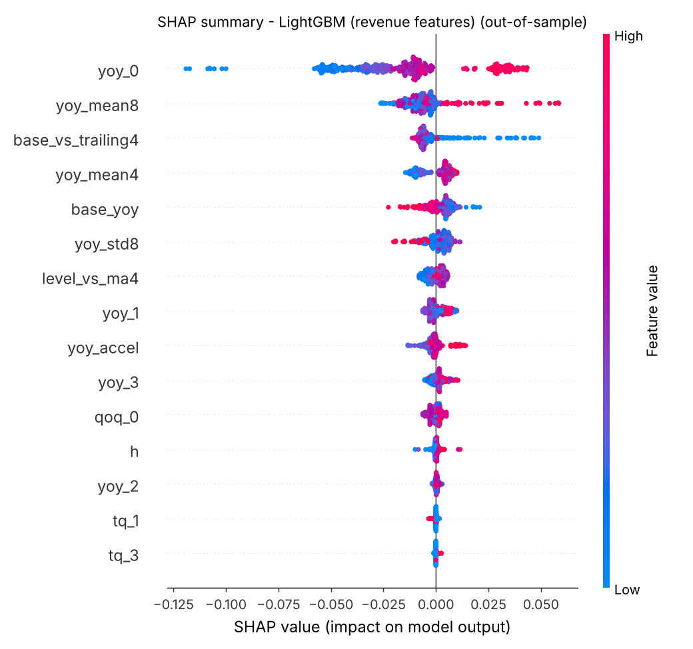
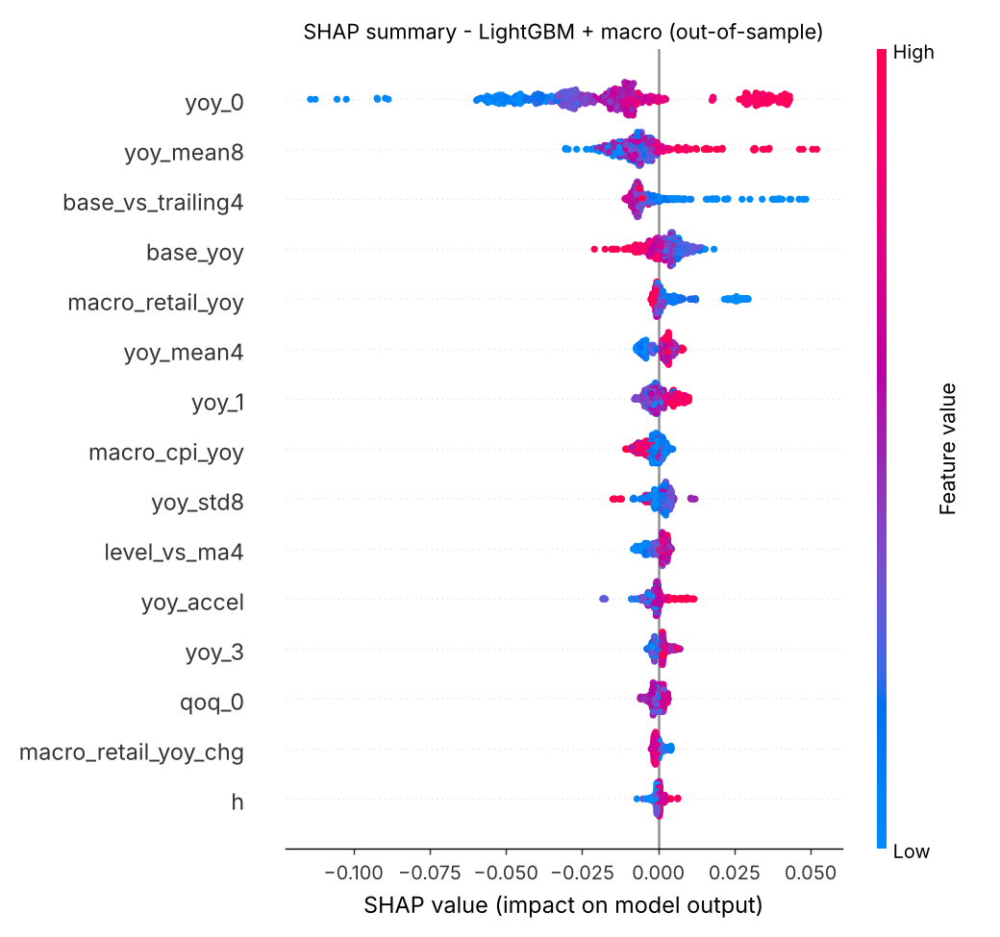

# Explainability (SHAP, out-of-sample)

SHAP values are computed by each fold's model on that fold's test rows only, so they describe what the model used when it made real backtest forecasts. Units are YoY log growth: a mean |SHAP| of 0.01 moves the forecast by roughly 1% of revenue.

## LightGBM (revenue features)

480 out-of-sample rows (12 folds).

| Rank | Feature | Mean abs SHAP | Meaning |
|---|---|---|---|
| 1 | `yoy_0` | 0.0273 | YoY log growth of the latest reported quarter |
| 2 | `yoy_mean8` | 0.0093 | mean YoY growth over the last 8 quarters (rolling mean) |
| 3 | `base_vs_trailing4` | 0.0069 | base quarter vs trailing-4-quarter average (seasonal position) |
| 4 | `yoy_mean4` | 0.0065 | mean YoY growth over the last 4 quarters (rolling mean) |
| 5 | `base_yoy` | 0.0048 | YoY growth the base quarter (t-4) itself had |
| 6 | `yoy_std8` | 0.0038 | volatility of YoY growth over the last 8 quarters |
| 7 | `level_vs_ma4` | 0.0029 | latest quarter vs trailing-4-quarter average |
| 8 | `yoy_1` | 0.0029 | YoY log growth one quarter earlier |
| 9 | `yoy_accel` | 0.0025 | latest YoY growth minus YoY growth a year earlier (acceleration) |
| 10 | `yoy_3` | 0.0022 | YoY log growth three quarters earlier |
| 11 | `qoq_0` | 0.0017 | QoQ log change of the latest quarter |
| 12 | `h` | 0.0008 | forecast horizon in quarters (1-4) |
| 13 | `yoy_2` | 0.0005 | YoY log growth two quarters earlier |
| 14 | `tq_1` | 0.0003 | target quarter is calendar Q1 |
| 15 | `tq_3` | 0.0002 | target quarter is calendar Q3 |
| 16 | `tq_2` | 0.0001 | target quarter is calendar Q2 |
| 17 | `tq_4` | 0.0001 | target quarter is calendar Q4 |

### Largest errors and what drove them

| Company | Target | h | Actual ($M) | Forecast ($M) | APE % | Top 3 SHAP contributions |
|---|---|---|---|---|---|---|
| NKE | 2024Q3 | 3 | 11,589 | 13,673 | 18.0 | yoy_0 -0.027, yoy_3 +0.008, base_yoy +0.008 |
| NKE | 2024Q3 | 4 | 11,589 | 13,649 | 17.8 | yoy_0 -0.025, yoy_mean8 -0.008, base_yoy +0.008 |
| GOOGL | 2022Q4 | 2 | 76,048 | 88,174 | 15.9 | yoy_mean8 +0.059, yoy_0 +0.043, base_yoy -0.015 |
| GOOGL | 2023Q1 | 3 | 69,787 | 80,392 | 15.2 | yoy_mean8 +0.058, yoy_0 +0.042, yoy_mean4 +0.010 |
| HD | 2025Q4 | 4 | 38,198 | 43,904 | 14.9 | yoy_0 +0.037, yoy_accel +0.013, yoy_mean8 -0.012 |
| NKE | 2024Q3 | 2 | 11,589 | 13,270 | 14.5 | yoy_0 -0.032, yoy_mean4 -0.009, base_yoy +0.009 |
| NKE | 2024Q4 | 4 | 12,354 | 14,123 | 14.3 | yoy_0 -0.027, yoy_3 +0.008, yoy_mean8 -0.007 |
| NKE | 2025Q2 | 4 | 11,097 | 12,615 | 13.7 | yoy_0 -0.049, yoy_mean4 -0.013, base_yoy +0.006 |

### Companies where it does not beat the best baseline (MASE)

| Company | Model MASE | Best baseline | Baseline MASE |
|---|---|---|---|
| AMZN | 0.681 | ets | 0.527 |
| GOOGL | 0.601 | ets | 0.400 |
| HD | 1.354 | seasonal_naive | 0.992 |
| MSFT | 1.012 | ets | 0.854 |
| NKE | 1.195 | naive | 0.819 |
| PG | 0.631 | seasonal_naive | 0.575 |
| TGT | 0.948 | seasonal_naive | 0.634 |

## LightGBM + macro

480 out-of-sample rows (12 folds).

| Rank | Feature | Mean abs SHAP | Meaning |
|---|---|---|---|
| 1 | `yoy_0` | 0.0274 | YoY log growth of the latest reported quarter |
| 2 | `yoy_mean8` | 0.0089 | mean YoY growth over the last 8 quarters (rolling mean) |
| 3 | `base_vs_trailing4` | 0.0071 | base quarter vs trailing-4-quarter average (seasonal position) |
| 4 | `base_yoy` | 0.0047 | YoY growth the base quarter (t-4) itself had |
| 5 | `macro_retail_yoy` | 0.0039 | US retail sales YoY growth, latest published quarter |
| 6 | `yoy_mean4` | 0.0035 | mean YoY growth over the last 4 quarters (rolling mean) |
| 7 | `yoy_1` | 0.0030 | YoY log growth one quarter earlier |
| 8 | `macro_cpi_yoy` | 0.0026 | US CPI YoY inflation, latest published quarter |
| 9 | `yoy_std8` | 0.0025 | volatility of YoY growth over the last 8 quarters |
| 10 | `level_vs_ma4` | 0.0024 | latest quarter vs trailing-4-quarter average |
| 11 | `yoy_accel` | 0.0021 | latest YoY growth minus YoY growth a year earlier (acceleration) |
| 12 | `yoy_3` | 0.0016 | YoY log growth three quarters earlier |
| 13 | `qoq_0` | 0.0013 | QoQ log change of the latest quarter |
| 14 | `macro_retail_yoy_chg` | 0.0010 | change in retail sales YoY growth vs prior quarter |
| 15 | `h` | 0.0008 | forecast horizon in quarters (1-4) |
| 16 | `yoy_2` | 0.0004 | YoY log growth two quarters earlier |
| 17 | `tq_1` | 0.0003 | target quarter is calendar Q1 |
| 18 | `tq_3` | 0.0001 | target quarter is calendar Q3 |
| 19 | `tq_4` | 0.0001 | target quarter is calendar Q4 |
| 20 | `tq_2` | 0.0000 | target quarter is calendar Q2 |

### Largest errors and what drove them

| Company | Target | h | Actual ($M) | Forecast ($M) | APE % | Top 3 SHAP contributions |
|---|---|---|---|---|---|---|
| NKE | 2024Q3 | 3 | 11,589 | 13,831 | 19.3 | yoy_0 -0.028, base_yoy +0.013, yoy_mean8 -0.007 |
| NKE | 2024Q3 | 4 | 11,589 | 13,668 | 17.9 | yoy_0 -0.024, base_yoy +0.008, yoy_mean8 -0.007 |
| NKE | 2024Q4 | 4 | 12,354 | 14,321 | 15.9 | yoy_0 -0.028, base_yoy +0.014, macro_retail_yoy +0.008 |
| GOOGL | 2022Q4 | 2 | 76,048 | 87,520 | 15.1 | yoy_mean8 +0.052, yoy_0 +0.043, base_yoy -0.013 |
| NKE | 2024Q3 | 2 | 11,589 | 13,273 | 14.5 | yoy_0 -0.035, base_yoy +0.011, yoy_mean4 -0.006 |
| NKE | 2025Q2 | 4 | 11,097 | 12,691 | 14.4 | yoy_0 -0.050, base_vs_trailing4 -0.006, base_yoy +0.006 |
| HD | 2025Q4 | 4 | 38,198 | 43,514 | 13.9 | yoy_0 +0.039, yoy_mean8 -0.015, yoy_accel +0.011 |
| GOOGL | 2023Q1 | 3 | 69,787 | 79,285 | 13.6 | yoy_mean8 +0.051, yoy_0 +0.042, macro_cpi_yoy -0.010 |

### Companies where it does not beat the best baseline (MASE)

| Company | Model MASE | Best baseline | Baseline MASE |
|---|---|---|---|
| AMZN | 0.678 | ets | 0.527 |
| GOOGL | 0.596 | ets | 0.400 |
| HD | 1.357 | seasonal_naive | 0.992 |
| MSFT | 0.970 | ets | 0.854 |
| NKE | 1.288 | naive | 0.819 |
| PG | 0.642 | seasonal_naive | 0.575 |
| TGT | 0.948 | seasonal_naive | 0.634 |
| WMT | 0.639 | ets | 0.610 |

